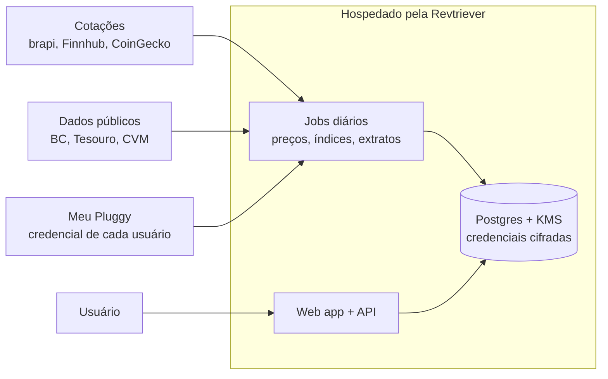

# Viabilidade técnica e de negócio

Análise feita em outubro de 2026, antes de qualquer implementação.

## Resumo

Os dois módulos são tecnicamente viáveis com custo de operação perto de zero e sem depender de IA. O único ponto que ameaça o "gratuito" é o Open Finance, resolvido com as credenciais do próprio usuário no Meu Pluggy.

- **Produto:** plataforma financeira open source e gratuita com dois módulos, gestão patrimonial e gestão de gastos.
- **Objetivo:** marca pessoal e relevância no mercado, não receita direta.
- **Entidade:** a Revtriever hospeda a versão oficial e responde pelos termos de uso e pela LGPD.
- **Público:** investidor de longo prazo com patrimônio espalhado entre Brasil, EUA e cripto.

## Módulo de gestão patrimonial

Responde em segundos "como meu patrimônio está distribuído" e "onde estou desbalanceado em relação à minha meta". Complexidade baixa a média; a parte mais trabalhosa é a renda fixa.

**Fluxo:** o usuário cadastra os ativos à mão, o sistema valoriza e classifica tudo, consolida em uma moeda base e compara com a carteira-alvo em duas camadas (classe → ativo dentro da classe).

### Escopo

- Uma carteira por conta, sem divisão por membro da família.
- Moeda base escolhida (BRL ou USD), com conversão pela PTAX do dia.
- Renda variável e cripto: só a posição atual (quantidade e preço médio opcional). Sem histórico de transações e sem eventos corporativos; num desdobramento, o usuário edita a quantidade.
- Renda fixa: cadastro do título (valor aplicado, data, indexador, taxa, vencimento) e valorização automática. Nunca atualizar saldo à mão.
- Classificação determinística por exposição, sem IA, editável pelo usuário; as classes também são editáveis.

### Regras de cadastro

- O mesmo ativo não pode ser cadastrado duas vezes. Ao escolher um ticker que já está na carteira, o sistema leva à posição existente para editar a quantidade.
- Renda fixa não tem ticker: dois CDBs do mesmo banco com taxas ou datas diferentes são títulos distintos e podem coexistir.
- A carteira pode ser baixada em planilha (.xlsx ou .csv) com ativo, classe, quantidade, valor e fonte do valor.

### Fontes de dados (todas públicas ou com plano gratuito)

| Ativo | Fonte | Precisão |
| --- | --- | --- |
| Ações, FIIs, ETFs, BDRs (B3) | brapi.dev; tipo pelo cadastro de instrumentos da B3 | Cotação com atraso, suficiente |
| Ações, ETFs, REITs (EUA) | Finnhub, Alpha Vantage ou Twelve Data | Cotação com atraso, suficiente |
| Cripto | CoinGecko | Boa |
| Câmbio | PTAX do Banco Central | Exata |
| Tesouro Direto | Preço oficial diário do Tesouro (dados abertos) | Exata |
| Fundos (inclusive muitos de previdência) | Cota diária da CVM, por CNPJ | Exata |
| CDB, LCI, LCA, LC (% do CDI) | CDI acumulado, série SGS do BC | Muito boa |
| Prefixado | Taxa contratada | Muito boa (na curva) |
| IPCA+ | IPCA do BC + taxa | Boa (mês corrente estimado) |
| Debêntures, CRI, CRA | Indexador + taxa | Aproximada (na curva) |
| Renda fixa EUA | Taxa contratada; preço público do Treasury | Boa |

**Armadilhas da classificação:** IVVB11 é negociado na B3, mas expõe a ações dos EUA; BDR é empresa estrangeira; FII pode ser tratado como "imóveis" ao lado de REITs. Solução: um mapa curado de ETFs em arquivo no repositório, que a comunidade corrige por PR.

**Diferencial, o aporte inteligente:** dado um valor novo ("tenho R$ 10 mil"), o sistema calcula onde aportar, nas duas camadas, para aproximar a carteira da meta sem vender nada (vender gera IR). Faixas de tolerância evitam alerta por desvio pequeno.

**Fora do MVP:** transações, rentabilidade, IR, dividendos.

## Módulo de gestão de gastos

Baixa os gastos, classifica por categoria e sugere onde cortar para bater a meta de economia mensal. Classificação e sugestão funcionam sem IA; a parte difícil é o acesso ao Open Finance.

### Acesso aos dados: credencial do usuário, hospedagem nossa

No Open Finance Brasil a pessoa física não gera chave de API própria: só instituições autorizadas recebem os dados. O caminho gratuito é o [Meu Pluggy](https://github.com/pluggyai/meu-pluggy):

1. O usuário cria conta em [meu.pluggy.ai](https://meu.pluggy.ai) e conecta os próprios bancos pelo Open Finance.
2. Cria a conta de desenvolvedor em [dashboard.pluggy.ai](https://dashboard.pluggy.ai) (teste de 15 dias; o acesso aos dados continua depois), inclui o conector MeuPluggy e cria uma aplicação, que gera Client ID e Client Secret.
3. Na Demo da aplicação, autoriza o Meu Pluggy uma vez por banco e copia o Item ID de cada um.
4. Cola tudo na Vera, que passa a puxar as transações.

O [Actual Budget](https://actualbudget.org/docs/advanced/bank-sync/pluggyai) usa esse mesmo fluxo. Para comparar, o acesso comercial custa em torno de R$ 2,5 mil/mês na Pluggy, R$ 6 mil/mês na Belvo e R$ 1,5 mil + R$ 540/mês na Tecnospeed, [segundo um dev que cotou](https://www.tabnews.com.br/GuilhermeVieira/estou-desenvolvendo-um-app-de-financas-pessoais-e-nao-consigo-pagar-o-open-finance-pluggy-r2-5k-mes-belvo-r6k-mes-tecnospeed-r1-5k-de-entrada-r540) (valores podem estar desatualizados).

**Importação de arquivo (OFX, CSV, fatura do cartão)** fica como base universal: funciona com qualquer banco e é o plano B se o Meu Pluggy mudar.

### Classificação sem IA

- Categoria que o agregador já entrega (qualidade a confirmar).
- Dicionário de estabelecimentos curado no repositório ("UBER" → transporte, "IFOOD" → delivery).
- Regras aprendidas com as correções do usuário ("Pix para João Silva = aluguel", para sempre).
- IA só como opcional, com a chave do próprio usuário, para a sobra que as regras não pegam.

O caso difícil é Pix para pessoa física, que nem a IA adivinha; só o usuário resolve, uma vez. Estimativa, não medida: 80 a 90% classificado sozinho depois do primeiro mês.

### Sugestão de corte (determinística)

1. A meta de economia (ex.: 20% da renda) contra o realizado define quanto falta por mês.
2. Categorias são marcadas como fixas (aluguel, escola, saúde) ou flexíveis (lazer, delivery, assinaturas).
3. Cada flexível é comparada com a média dos meses anteriores do próprio usuário.
4. O corte necessário é distribuído entre as flexíveis, começando pelas que mais desviaram.

As transações também podem ser baixadas em planilha (.xlsx ou .csv), com data, descrição, valor, categoria e origem.

## Arquitetura e custos

A Revtriever hospeda um único app; o custo cresce com o número de ativos distintos, não com o número de usuários.

Mil pessoas com ITUB4 geram uma consulta de preço por dia. O Open Finance roda na credencial de cada usuário, então também não pesa na conta. O custo esperado é só de servidor e banco, provavelmente dezenas de dólares por mês no começo (estimativa).

- **Login:** só login social, com Google e Facebook (OAuth). A plataforma não guarda senha própria.
- **Segurança:** Client Secret de cada usuário cifrado com KMS desde o primeiro dia, nunca em texto puro nem em log.
- **LGPD:** a Revtriever é controladora de dados patrimoniais e bancários; termos, política de privacidade e exclusão de conta entram no MVP.
- **Hospedagem própria:** o código aberto permite que qualquer pessoa rode a Vera sozinha, com as próprias chaves.

## Negócio

Como o objetivo é relevância, o concorrente que importa é outro open source gratuito; os pagos (Kinvo, Gorila, Investidor10) não.

- **Posicionamento:** "a ferramenta aberta de carteira-alvo para quem investe no Brasil e lá fora". O Ghostfolio provavelmente cobre o genérico (ações, cripto, multimoeda) e não o brasileiro (CDB na curva, Tesouro oficial, cota CVM, ETF da B3 por exposição). Hipótese ainda não verificada.
- **Público existe:** a metodologia da Bastter e o Método ARCA são alocação-alvo por classe, hoje feita em planilha.
- **Marca pessoal:** o fundador aparece como autor (repositório, README, site); a Revtriever é a entidade dos termos e da LGPD.
- **Licença:** AGPL-3.0, para que ninguém feche o código e ofereça como serviço sem devolver melhorias.
- **Parceria com a Pluggy:** um open source que leva usuários ao Meu Pluggy dá visibilidade à marca deles; pode render cota gratuita e esclarecer os termos.

## Pontos em aberto

- Os termos do Meu Pluggy permitem que um serviço hospedado guarde as credenciais dos usuários?
- Conexões só podem ser criadas durante o teste do painel; dá para renovar consentimento depois?
- Qual a qualidade da categorização que a Pluggy já entrega?
- O Ghostfolio ou outro open source já faz carteira-alvo em duas camadas com foco Brasil?
- O nome Vera está livre (domínio, INPI, GitHub)?
- Qual a stack técnica?

## Fontes

- [Meu Pluggy: instruções oficiais](https://github.com/pluggyai/meu-pluggy)
- [Actual Budget: setup do Pluggy.ai](https://actualbudget.org/docs/advanced/bank-sync/pluggyai)
- [TabNews: preços de Open Finance para app de finanças pessoais](https://www.tabnews.com.br/GuilhermeVieira/estou-desenvolvendo-um-app-de-financas-pessoais-e-nao-consigo-pagar-o-open-finance-pluggy-r2-5k-mes-belvo-r6k-mes-tecnospeed-r1-5k-de-entrada-r540)
- [Finsiders: Pluggy lança o hub Meu Pluggy](https://finsidersbrasil.com.br/reportagem-exclusiva-fintechs/pluggy-lanca-hub-para-facilitar-a-vida-de-quem-quer-compartilhar-dados-financeiros-e-simplificar-a-lgpd-diz-socio/)
